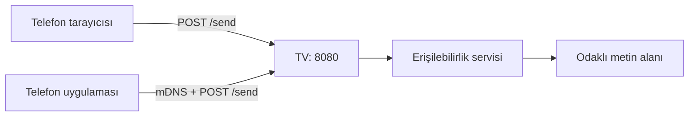

# TVPaste

Telefondan veya tarayıcıdan Android TV'deki seçili metin alanına yazı gönderir.

TVPaste iki parçadan oluşur: TV uygulaması ve telefon uygulaması.
TV uygulaması küçük bir HTTP sunucusu açar.
Gelen metni o an odaklı olan metin alanına yazar.
Telefon uygulaması TV'yi ağda bulur ve metni gönderir.
Tarayıcı da aynı işi yapar; telefon uygulaması şart değildir.

## 🚀 Hızlı Başlangıç
Gerekli ortam: Windows, JDK 21, Android SDK ve aynı Wi-Fi ağı.
Android Studio `local.properties` dosyasını kendisi oluşturur.

1. Projeyi derle.

```powershell
gradlew.bat assembleDebug
```

2. TV'ye kablosuz bağlan.

```powershell
adb connect TV_IP:5555
adb devices
```

3. TV uygulamasını kur.

```powershell
adb install -r tv\build\outputs\apk\debug\tv-debug.apk
```

4. Gerekli izinleri ver.

```powershell
adb shell appops set com.tvpaste.tv AUTO_START allow
adb shell appops set com.tvpaste.tv ACCESS_RESTRICTED_SETTINGS allow
adb shell settings put secure enabled_accessibility_services com.tvpaste.tv/com.tvpaste.tv.PasteService
adb shell settings put secure accessibility_enabled 1
```

5. TVPaste'yi aç. Ekranda `Erişilebilirlik servisi: AÇIK` ve `Sunucu: ÇALIŞIYOR` yazmalı.

6. Telefon tarayıcısından `http://TV_IP:8080` adresini aç.

İsteğe bağlı telefon uygulaması:

```powershell
adb install -r phone\build\outputs\apk\debug\phone-debug.apk
```

## 📖 Nasıl Çalışır


Erişilebilirlik servisi açıkken TV uygulaması sunucuyu başlatır.
Servis, `_tvpaste._tcp.` tipiyle ağda kendini duyurur.
Telefon uygulaması bu yayını bulur; bulamazsa elle IP kullanır.
Metin `POST /send` ile gönderilir.
TV sunucusu metni odaklı alana ekler; mevcut metni silmez.
Tarayıcı arayüzü `GET /` ve `GET /index.html` ile gelir.
Sayfa tek dosyadır; dışarıdan hiçbir kaynak yüklemez.

## ⚙️ Ayarlar
| Ayar | Değer | Kaynak |
|---|---|---|
| HTTP portu | 8080 | `TvPasteConfig.kt` |
| Servis tipi | `_tvpaste._tcp.` | `TvPasteConfig.kt` |
| Servis adı | TVPaste | `TvPasteConfig.kt` |
| Gövde sınırı | 100 KB | `HttpRequest.kt` |
| Socket zaman aşımı | 5 saniye | `SimpleHttpServer.kt` |
| Yazma zaman aşımı | 2 saniye | `RequestHandler.kt` |
| Telefon HTTP zaman aşımı | 3 saniye | `TvClient.kt` |
| Telefon keşif süresi | 8 saniye | `phone/MainActivity.kt` |
| Web istek süresi | 5 saniye | `index.html` |
| TV ekran yenileme | 3 saniye | `tv/MainActivity.kt` |
| En düşük TV sürümü | Android 9 (API 28) | `tv/build.gradle.kts` |
| En düşük telefon sürümü | Android 8.0 (API 26) | `phone/build.gradle.kts` |

## 🗂️ Dosyalar
| Yol | İçerik |
|---|---|
| `tv/` | TV uygulaması: erişilebilirlik servisi ve HTTP sunucusu |
| `phone/` | Telefon uygulaması: keşif, elle IP ve gönderim |
| `tv/src/main/assets/index.html` | Web arayüzü: HTML, CSS ve JavaScript tek dosyada |
| `tv/src/main/res/drawable/ic_launcher_foreground.xml` | Uygulama logosu |
| `tv/src/main/res/drawable/tv_banner.xml` | TV launcher banner'ı |
| `docs/ADB_KOMUTLARI.md` | Ayrıntılı ADB komutları |
| `PLAN.md` | Proje planı ve aşamalar |

Projede harici kütüphane yoktur. Sadece Android SDK ve Kotlin standart kütüphanesi kullanılır.

## 🛠️ Sorun Giderme

**`Servis çalışmıyor. ADB ile açın veya TV ayarlarından erişilebilirliği kontrol edin.`**

`AUTO_START` iznini ver. Sonra servisi kapat-aç.

```powershell
adb shell appops set com.tvpaste.tv AUTO_START allow
adb shell settings put secure enabled_accessibility_services ""
adb shell settings put secure accessibility_enabled 0
adb shell settings put secure enabled_accessibility_services com.tvpaste.tv/com.tvpaste.tv.PasteService
adb shell settings put secure accessibility_enabled 1
```

Servisin bağlandığını kontrol et:

```powershell
adb shell dumpsys accessibility | Select-String "Bound services"
```

**`Sunucu: ÇALIŞMIYOR`**

Erişilebilirlik kapalı olabilir. Port 8080 dolu olabilir. TV'yi yeniden başlat.

**`TV bulunamadı (elle IP girebilirsin)`**

Telefon ve TV aynı Wi-Fi ağında olmalı. Router'da istemci izolasyonu kapalı olmalı.
TV ekranındaki IP'yi telefon uygulamasına elle gir.

**`TV'de seçili metin alanı yok`**

TV'de bir metin alanına tıkla. Klavye açıldıktan sonra tekrar gönder.

**`TV'ye ulaşılamadı`**

TV açık mı ve aynı ağda mı? IP ve port doğru mu? Güvenlik duvarı engelliyor olabilir.

**`Önce bir yazı girin`**

Yazı kutusu boş. Önce bir metin yaz.

**`Gönderildi`**

Metin TV'ye ulaştı ve odaklı alana yazıldı.

**`TV hata döndü (kod)`**

TV farklı bir HTTP kodu döndürdü. Kodu ve logcat'i kontrol et.

**Play Protect `Uygulama engellendi` diyor**

Android 13+ sürümlerde USB kurulumu engellenir. Uygulama erişilebilirlik servisi bildirir.
ADB ile kur veya Play Store kullan. Kurucu APK bu engeli aşmaz.

**Erişilebilirlik anahtarı açılmıyor**

Android 13+ USB kurulumunda `ACCESS_RESTRICTED_SETTINGS` kapalıdır.
TCL TV'de "kısıtlı ayarlara izin ver" menüsü yoktur. ADB şarttır:

```powershell
adb shell appops set com.tvpaste.tv ACCESS_RESTRICTED_SETTINGS allow
```

## 🔐 Güvenlik
Uygulamada PIN veya şifre yoktur. `isAuthorized` şimdilik her isteği kabul eder.
Aynı ağdaki herkes TV'ye metin gönderebilir. Güvenli bir ağda kullan.
Trafik HTTP'dir; TLS yoktur. Metin ağda şifresiz gider.
Metin diske ve logcat'e yazılmaz. Sadece odaklı alana eklenir.
`ACTION_SET_TEXT` başarısız olursa metin TV panosuna kopyalanır.
Erişilebilirlik servisi pencere içeriğini okur. Sadece odaklı alanı kullanır.

## 📦 Dağıtım

Şu an kurulum ADB ile yapılır. Bu, geliştirici ve teknik kullanıcı içindir.

Android 12 ve altı TV'lerde USB kurulumu çalışır. Erişilebilirlik açılabilir.
Android 13 ve 14 TV'lerde iki engel vardır:

- Play Protect, erişilebilirlik bildiren APK'yı dosya yöneticisinden kurmaz.
- Kurulsa bile `ACCESS_RESTRICTED_SETTINGS` erişilebilirliği kilitler.

TCL TV'nin uygulama bilgisi ekranında bu kilidi açan menü yoktur.
Bu yüzden Android 13+ TV'lerde ADB veya Play Store gerekir.

Play Store yolu henüz kurulmadı. Sıradaki adım Play Console'dur.
Play Console hesabı tek seferlik 25 ABD dolarıdır. Yerel vergi eklenebilir.
Play sürümü release imza, ikon, gizlilik politikası ve erişilebilirlik beyanı ister.
Ret riski vardır; ücret iade edilmez.

## 🧪 Test

1. `gradlew.bat assembleDebug` komutunu çalıştır.
2. `adb connect TV_IP:5555` ile TV'ye bağlan.
3. TV APK'sını kur ve izinleri ver.
4. TVPaste'yi aç; `Erişilebilirlik servisi: AÇIK` yazsın.
5. `Sunucu: ÇALIŞIYOR` ve `Adres: ...:8080` yazsın.
6. Telefon tarayıcısından `http://TV_IP:8080` aç.
7. Kutuya `merhaba şğüöçı` yaz ve GÖNDER'e bas.
8. TV'de bir metin alanına tıkla; metin görünmeli.
9. Metin alanı seçili değilken gönder; `TV'de seçili metin alanı yok` yazmalı.
10. Tema düğmesine bas; açık ve koyu tema değişmeli.
11. TV'yi yeniden başlat; servis bağlanmazsa kapat-aç.
